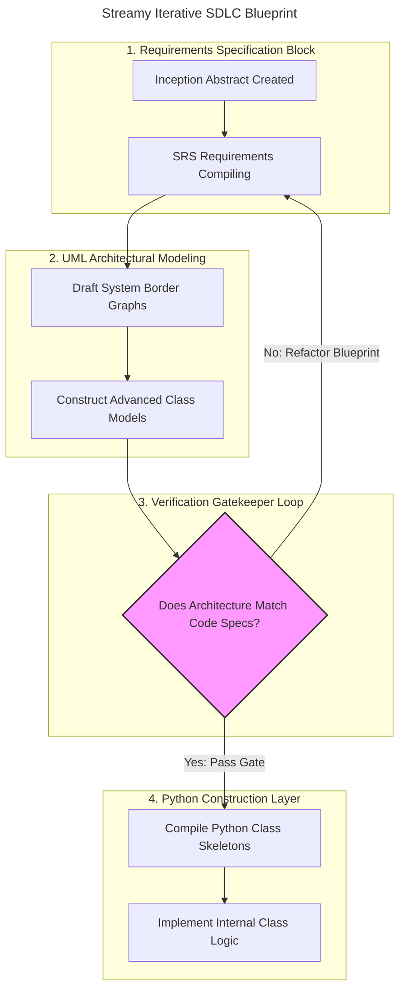

# Streamy Video Streaming Backend Platform

**Course:** GEIAL314-B2a — Software Technology Practical Lab
**Institution:** Institute of Information Science, University of Miskolc
**Author:** Jawad Ahmad Qasem Alshboul

Streamy is an object-oriented backend media catalogue engine for a digital video streaming
marketplace. It tracks, structures, and processes the relationships between media formats,
classification taxonomies, and user metric collections. This repository is the Docs-as-Code
workspace of the project: every architectural artefact is written in Markdown and modelled
with Mermaid so that the documentation is versioned, reviewable, and always in sync with the
implementation.

## Delivery Documents

| File | Contents | Introduced in |
|---|---|---|
| [`abstract.md`](abstract.md) | Project inception, system boundaries, core domain entities | Lab 2 |
| [`SRS.md`](SRS.md) | Functional (FR-1..FR-5) and non-functional (NFR-1..NFR-3) requirements, system border diagram | Lab 4 |
| [`sprint_architecture.md`](sprint_architecture.md) | Kanban sprint lifecycle and issue decomposition | Lab 5 |
| [`interactions.md`](interactions.md) | UML sequence diagrams, C4 component view, decision flow | Lab 6 |
| [`domain_model.md`](domain_model.md) | UML class associations and relational persistence schema | Lab 7 |

## Engineering Lifecycle

To guarantee systematic software tracking across the implementation lifespan of **Streamy**, the
developer pipeline follows the structured iterative gate review framework illustrated below.

## Workflow Convention

Work is never committed straight to `main`. Every artefact is produced on a short-lived feature
branch, published as a Pull Request that closes the matching sprint-board issue, reviewed against
the documented architectural checklist, merged, and the branch is then removed. Sprint state lives
on the GitHub Project board **Streamy Development Sprint Board**.
