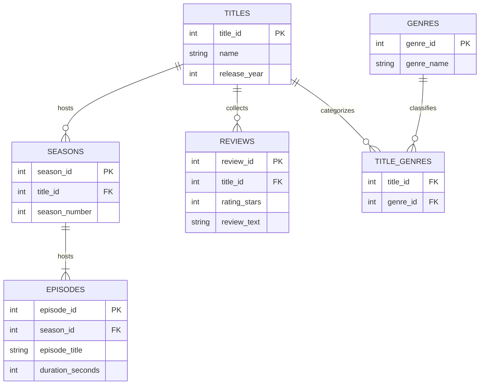

# Streamy Relational Database Persistence Schema

## Physical Storage Specification and Foreign Key Integrity Map

The logical domain model defined in `domain_model.md` is realised here as a physical, third-normal-form relational ledger. Every table below declares a primary key, every reference declares a foreign key, and the crow's-foot notation states the exact row multiplicity that the persistence layer has to enforce.

### 1. Schema Design Intent

The mapping follows three rules that keep the storage layer honest:

- **One noun, one table.** Each entity of the class model earns exactly one base table, so no table mixes two lifetimes.
- **Associations become join tables.** The many-to-many links (titles to genres, titles to actors) are decomposed into link tables whose composite primary key is itself the pair of foreign keys, which makes duplicate rows structurally impossible.
- **Ownership is expressed by the key chain.** A season cannot exist without its title and an episode cannot exist without its season, so the foreign key to the parent is part of the child's identity path rather than an optional annotation.

### 2. Relational Entity Relationship Diagram

### 3. Cardinality Reference Sheet

| Relationship | Notation | Reading |
| --- | --- | --- |
| TITLES to SEASONS | `||--o{` | A title may have zero or many seasons; every season belongs to exactly one title. |
| SEASONS to EPISODES | `||--|{` | A season owns one or many episodes; every episode belongs to exactly one season. |
| TITLES to REVIEWS | `||--o{` | A title may collect zero or many reviews; every review is attached to exactly one title. |
| TITLES to TITLE_GENRES | `||--o{` | A title may be filed under zero or many genres through the link table. |
| GENRES to TITLE_GENRES | `||--o{` | A genre may classify zero or many titles; a genre with no titles is still legal. |

### 4. Integrity and Traceability Note

Deleting a title cascades to its seasons, its episodes, its reviews and its genre links, because none of those rows carries meaning on its own. The composite key on `TITLE_GENRES` protects the catalogue from duplicate classifications, and the storage of `rating_stars` as a bounded integer keeps the review metric comparable across the API surface described in `SRS.md` (FR-2 title catalogue, FR-1 genre taxonomy, FR-3 review collection). The diagram therefore describes the same three requirements from the persistence side that `domain_model.md` describes them from the object side.
