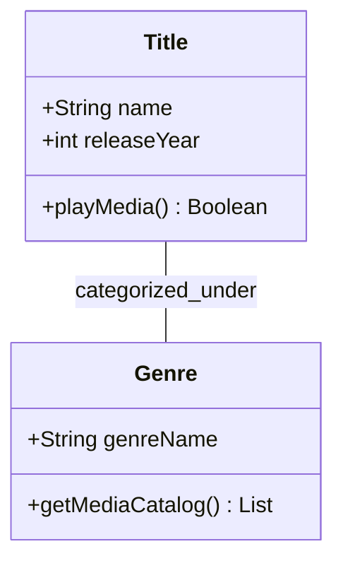
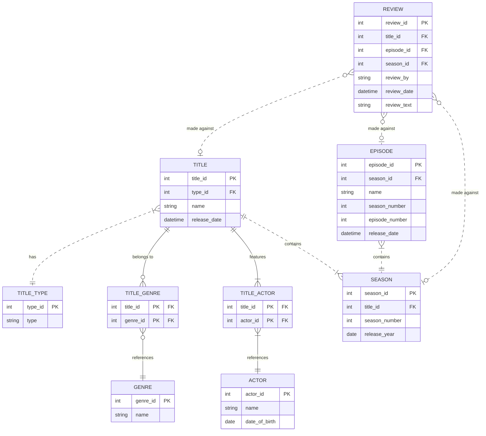

# Streamy Core Domain Structural Architecture

## Foundational Object-Oriented Entity Specifications

### 1. Conceptual Domain Breakdown
This tracking document establishes the baseline static structures for the Streamy streaming platform codebase. By translating system requirements nouns straight into unified class schemas, we guarantee the underlying database and Python structures align perfectly.

The domain nouns are extracted directly from the verified requirements document [`SRS.md`](SRS.md): **Title** (FR-2, the central media entity), **Genre** (FR-1, the classification taxonomy) and **Review** (FR-3, the user metric collection).

### 2. Base Entity Model Class Diagram
The architectural class schema below plots our primary data properties, encapsulation metrics, and loose directional system associations:

### 3. Relational Persistence Schema (Entity Relationship Diagram)
The class model above is translated into the physical storage ledger below. Entities are upper-cased, every field declares its datatype and key role, and both identifying (solid) and non-identifying (dashed) relationships are modelled with full crow's-foot cardinalities.

