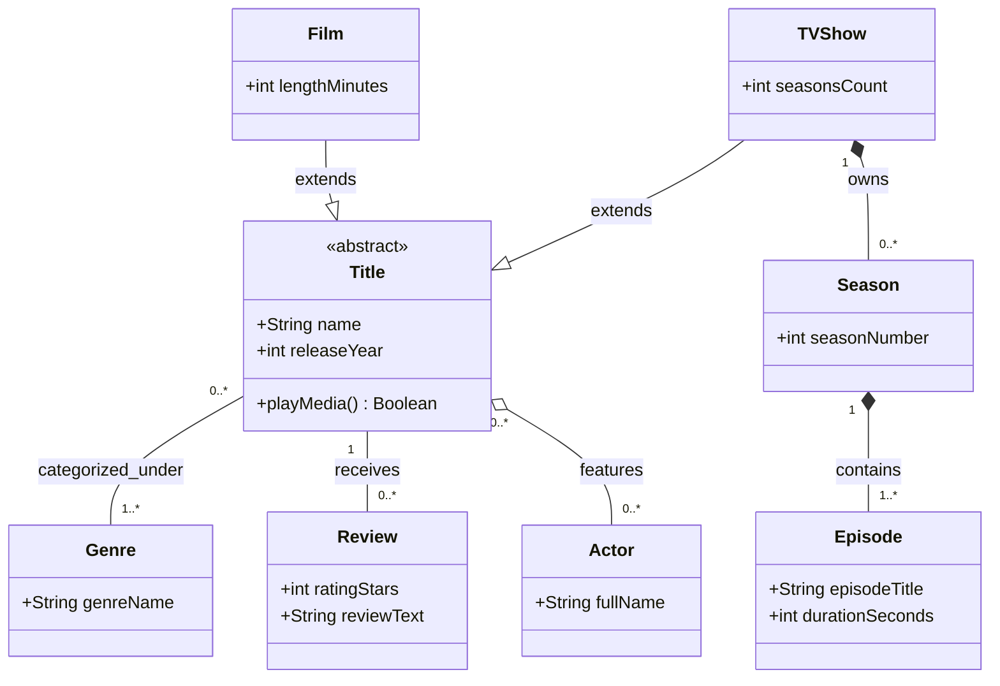
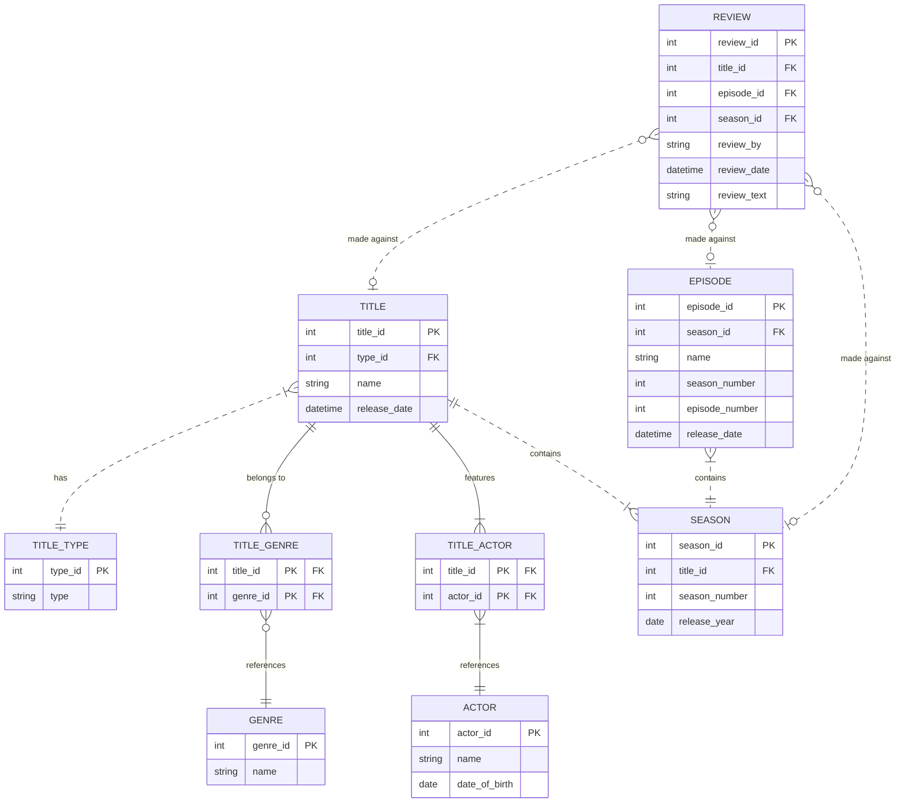

# Streamy Core Domain Structural Architecture

## Advanced Object-Oriented System Entity Specifications

### 1. Complex System Relationships Analysis
This document is the structural blueprint for the Streamy runtime. Plain associations were enough for the baseline catalogue, but the production model also has to express inheritance, strong whole-part ownership and shared references, and every link has to state how many objects may sit at each end.

- **Generalization** (`--|>`) describes an *is-a* hierarchy: `Film` and `TVShow` specialise the abstract `Title` and inherit its public attributes and behaviour. The hollow triangle points at the parent.
- **Composition** (`*--`) describes strong whole-part ownership: a `TVShow` owns its `Season` objects and a `Season` owns its `Episode` objects. Composition is a domain statement only; cascade deletion stays a database decision.
- **Aggregation** (`o--`) describes a shared part: an `Actor` can be featured across many titles and keeps an independent lifecycle, so the hollow diamond sits at the whole.

Multiplicity is read at the far end of a relationship, so `TVShow "1" *-- "0..*" Season` means one show owns zero or more seasons, while each season belongs to exactly one show.

### 2. Comprehensive Production Class Diagram
The schematic below carries the full eight-class structure: two specialisations of `Title`, the season/episode lifecycle, the shared `Actor` reference and the genre taxonomy. All seven relationships declare explicit cardinality bounds.

Every title is filed under at least one genre, while a genre may classify zero or more titles. Reviews hang off the title rather than off the playable media, so a review survives when an episode is re-cut.

### 3. Relational Persistence Schema (Entity Relationship Diagram)
The class model above is translated into the physical storage ledger below. Entities are upper-cased, every field declares its datatype and key role, and both identifying (solid) and non-identifying (dashed) relationships are modelled with full crow's-foot cardinalities.

### 4. Traceability Note
The entities and cardinalities above are traced back to the functional requirements in [`SRS.md`](SRS.md): FR-2 (title catalogue), FR-1 (genre taxonomy) and FR-3 (review collection), so the persistence ledger and the specification never drift apart. The composition links in section 2 are the ones mapped to `title_id` foreign keys in the season and episode tables.
