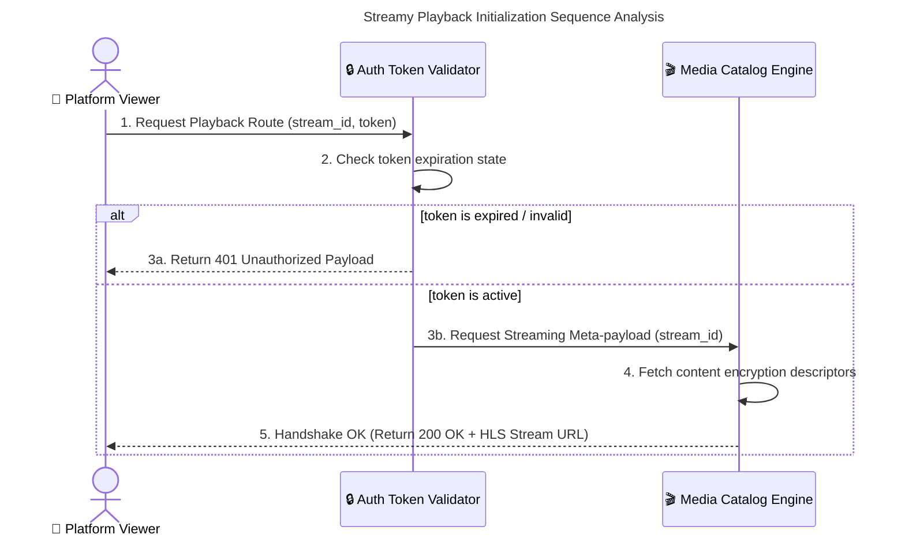
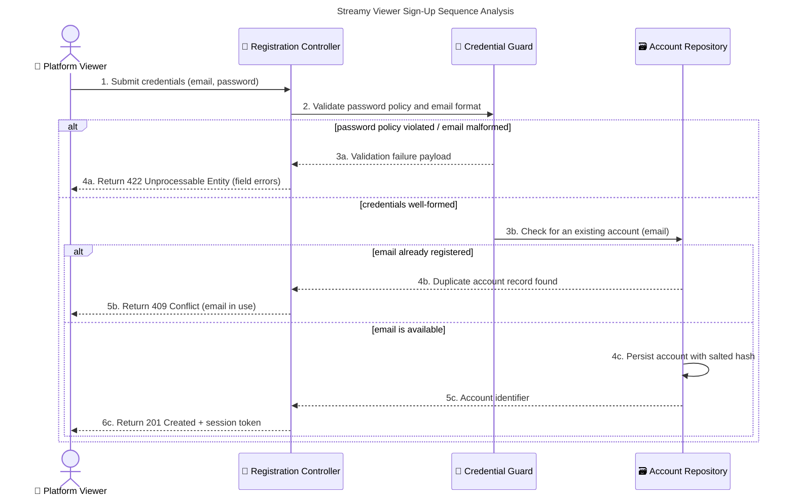
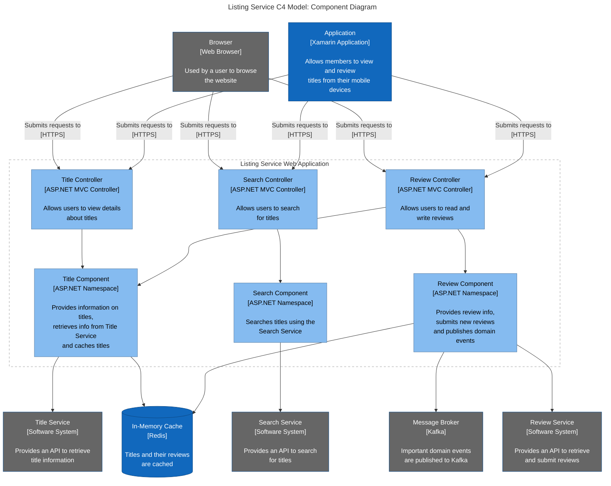
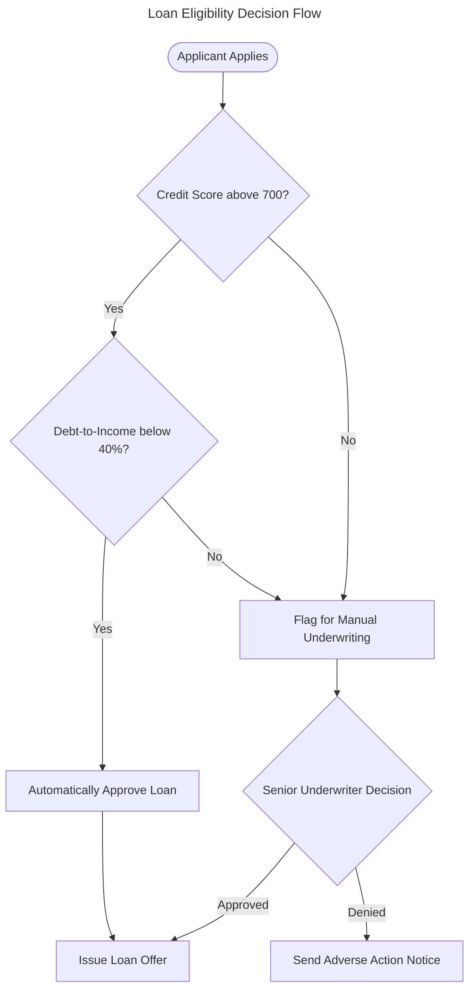

# Streamy Backend Dynamic Behavioral Modeling

## System Architecture Interaction Streams

### 1. Architectural Core Mechanics
This tracking document details how application payloads pass between data layers before structural code layers are compiled. By designing how inputs move through software boundaries beforehand, we ensure development velocity remains high.

### 2. Media Playback Transaction Loop
The sequence model below outlines how the system validates viewer access permissions before initiating video file playback:

### 3. Signed-Up Viewer Authentication Pipeline (Alternate Error Branches)
The second stream models the registration path, including the unhappy paths mandated by FR-4:

### 4. Component Structure of the Listing Container (C4 Component View)
Zooms inside the Streamy web application container to expose its controllers and namespaces. Callers sit above the boundary, internal components are rendered in pale blue, and downstream services and datastores are ranked below it.

### 5. Complex Branched Decision Logic
Where a scenario degenerates into nested decision engines, a sequence diagram stops being readable and a standard flowchart is the correct tool. The model below exercises the diamond decision node syntax:

